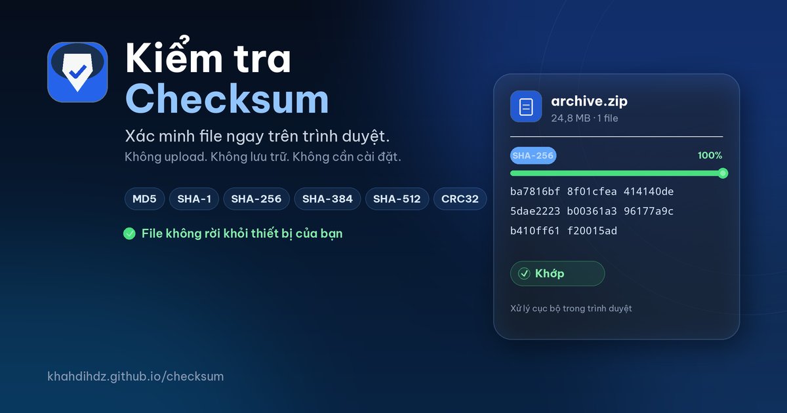

# Kiểm tra Checksum

[](https://github.com/khahdihdz/checksum/actions/workflows/deploy.yml)
[](https://khahdihdz.github.io/checksum/)
[](LICENSE)

Webapp tĩnh giúp tính và so khớp checksum file ngay trong trình duyệt. Không backend,
không upload, không analytics — file của bạn không rời khỏi thiết bị.

[**Mở webapp →**](https://khahdihdz.github.io/checksum/)



## Tổng quan

Khi tải file từ internet, checksum là cách nhanh nhất để kiểm tra file có bị hỏng,
thiếu byte hoặc bị thay đổi so với bản gốc hay không. Các công cụ truyền thống thường
yêu cầu cài đặt, dùng dòng lệnh hoặc tải file lên một máy chủ khác.

**Kiểm tra Checksum** giải quyết việc đó trong một tab trình duyệt:

1. Kéo-thả file cần kiểm tra.
2. Chọn thuật toán hoặc dán checksum mà nhà phát hành cung cấp.
3. Xem kết quả khớp/không khớp ngay lập tức.

Toàn bộ quá trình đọc file và tính hash diễn ra cục bộ. Không có dữ liệu nào được gửi
đi đâu, kể cả tên file.

## Tính năng

- **Kéo-thả hoặc chọn nhiều file** cùng lúc; hỗ trợ mọi định dạng file.
- **6 thuật toán:** MD5, SHA-1, SHA-256, SHA-384, SHA-512 và CRC32.
- **Streaming trong Web Worker:** đọc file theo chunk 4 MiB, có thanh tiến trình và
  nút hủy; không làm treo giao diện với file lớn.
- **So khớp thông minh:**
  - Tự nhận diện thuật toán theo độ dài checksum.
  - So sánh không phân biệt hoa/thường, bỏ qua khoảng trắng và tiền tố `0x`.
  - Hỗ trợ output của `md5sum`, `sha256sum` và `certutil`.
  - Ghép checksum với file theo tên hoặc theo thứ tự khi dán nhiều dòng.
- **Xuất kết quả:** copy từng checksum, copy tất cả hoặc tải file `.txt` theo định
  dạng `<hash>  <filename>`.
- **Giao diện sáng/tối**, responsive từ mobile đến desktop, có trạng thái lỗi và
  thông báo rõ ràng.
- **Không phụ thuộc backend**, có thể host trên bất kỳ static hosting nào.

## Cách hoạt động

1. Trình duyệt giữ tham chiếu đến file trên đĩa, không nạp toàn bộ file vào RAM.
2. Một Web Worker đọc lần lượt từng chunk 4 MiB bằng `File.slice().arrayBuffer()`.
3. `hash-wasm` cập nhật trạng thái hash sau mỗi chunk và trả về chuỗi hex khi hoàn tất.
4. Checksum tính được so sánh với checksum kỳ vọng; kết quả hiển thị theo từng file.
5. Worker bị hủy hoặc kết thúc khi bạn đổi thuật toán, xóa file hay đóng tab.

## Giới hạn dung lượng

Không có giới hạn cứng trong code. Giới hạn thực tế phụ thuộc vào RAM, CPU, tốc độ đĩa
và trình duyệt:

| Dung lượng | Trải nghiệm thực tế |
|---|---|
| Dưới 2 GB | Thoải mái trên desktop và mobile |
| 2–10 GB | Vẫn xử lý được, chậm hơn; cần đủ RAM và giữ tab mở |
| Trên 10 GB | Có thể chạy nếu trình duyệt/OS cho phép, phụ thuộc mạnh vào thiết bị |
| Hàng chục GB | Không bị chặn, nhưng nên cân nhắc công cụ native vì thời gian băm rất lâu |

App hiển thị badge **“File lớn”** khi file vượt 2 GB nhưng vẫn tiếp tục xử lý. Với file
lớn, nên dùng Chrome/Edge trên desktop, giữ tab ở foreground và tránh chuyển nền trên
mobile.

## Thuật toán hỗ trợ

| Thuật toán | Độ dài hex | Ghi chú |
|---|---:|---|
| CRC32 | 8 | Kiểm tra lỗi nhanh, không dùng cho mục đích bảo mật |
| MD5 | 32 | Tương thích rộng, không còn an toàn cho chữ ký số |
| SHA-1 | 40 | Tương thích cũ, không nên dùng cho mục đích bảo mật mới |
| SHA-256 | 64 | Phổ biến và cân bằng giữa tốc độ, độ an toàn |
| SHA-384 | 96 | Thuộc họ SHA-2, độ an toàn cao hơn SHA-256 |
| SHA-512 | 128 | Thuộc họ SHA-2, xử lý chậm hơn trên một số thiết bị |

## Công nghệ

- React 19 + TypeScript (strict)
- Vite 6
- `hash-wasm` cho MD5, SHA-1/256/384/512 và CRC32
- Web Worker + streaming theo chunk
- Vitest cho unit test
- ESLint
- GitHub Actions + GitHub Pages

## Chạy local

Yêu cầu Node.js 20 trở lên.

```bash
npm install
npm run dev
```

Các lệnh kiểm tra:

```bash
npm run lint
npm run typecheck
npm test -- --run
npm run build
```

`npm run build` tạo thư mục `dist/`, có thể deploy lên bất kỳ static hosting nào.

## Cấu trúc dự án

```text
src/
  components/       # Dropzone, Toolbar, FileRow, ExpectedInput, Features...
  lib/
    checksum.ts     # Parse, nhận diện và so khớp checksum
    hasher.ts       # Khởi tạo hash-wasm theo thuật toán
    hash.worker.ts  # Đọc file theo chunk và tính hash
    useHashQueue.ts # Hàng đợi job, hủy và reset worker
  App.tsx
  styles.css
  types.ts
public/
  og-image.png      # Ảnh chia sẻ mạng xã hội 1200x630
.github/workflows/
  deploy.yml        # Build, test và deploy GitHub Pages
```

## Deploy

Workflow [`.github/workflows/deploy.yml`](.github/workflows/deploy.yml) tự động:

1. Cài dependency bằng `npm ci`.
2. Chạy lint, typecheck và test.
3. Build bằng Vite.
4. Upload artifact và deploy lên GitHub Pages.

Workflow chạy mỗi khi push lên nhánh `main`, hoặc chạy thủ công từ tab **Actions**.

Lần đầu sử dụng, vào **Settings → Pages → Source** và chọn **GitHub Actions** nếu Pages
chưa được bật. Workflow cũng cố gắng bật Pages tự động bằng `actions/configure-pages`.

Sau khi workflow xanh:

```text
https://khahdihdz.github.io/checksum/
```

## Bảo mật và quyền riêng tư

- Không có backend, không upload file.
- Không analytics, không cookie theo dõi.
- Không gọi API bên thứ ba trong lúc tính checksum.
- Checksum chỉ được so sánh cục bộ trong bộ nhớ trình duyệt.

Lưu ý: checksum xác minh tính toàn vẹn dữ liệu, không thay thế chữ ký số hoặc kiểm tra
nguồn gốc tin cậy.

## Giấy phép

[MIT](LICENSE)
